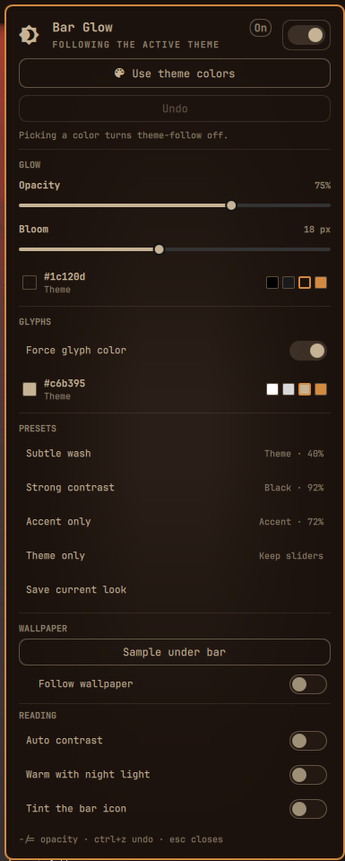

# Bar Glow

Full-width glow behind the **stock** Omarchy 4 (Quattro) bar, so icons and
labels stay readable on any wallpaper. A settings panel tunes opacity,
bloom, colors, presets, and an optional wallpaper sample. The bar icon
that opens it is optional.

It does **not** replace `omarchy.bar`. Third-party full-bar clones currently
fail to load because `Bar.qml` required properties are not injected at
construction
([#6915](https://github.com/basecamp/omarchy/issues/6915),
[#8007](https://github.com/basecamp/omarchy/issues/8007),
[#8202](https://github.com/basecamp/omarchy/issues/8202)).



## Install

```bash
omarchy plugin add https://github.com/07dcolem/bar-glow.git --enable
```

Omarchy will ask which bar section to use (default: **right**). That chip
opens the panel. The icon is optional; [Settings panel](#settings-panel)
explains how to remove it and still open the panel.

If the folder is already at `~/.config/omarchy/plugins/bar-glow/`:

```bash
omarchy plugin validate ~/.config/omarchy/plugins/bar-glow
omarchy-shell shell rescanPlugins
omarchy plugin enable bar-glow --section right
omarchy restart shell
```

Confirm:

```bash
hyprctl layers | grep -E 'omarchy-bar$|omarchy-bar-glow'
omarchy-shell bar-glow status
omarchy-shell bar-glow toggle
```

With a top bar you should see a **bottom-layer** wash covering the whole bar
strip, plus a short bloom on the inner edge:

```
Layer level 1 (bottom):
  ... xywh: 0 0 1920 44, namespace: omarchy-bar-glow
Layer level 2 (top):
  ... xywh: 0 0 1920 26, namespace: omarchy-bar
```

The glow uses `ExclusionMode.Ignore` (exclusive zone `-1`) so it does not
steal reserved space. It sits on `WlrLayer.Bottom`, so it shows through the
transparent bar and never covers widgets or popouts.

## Remove

```bash
omarchy plugin remove bar-glow
```

That deletes `~/.config/omarchy/plugins/bar-glow/` and removes the
plugin from `shell.json`. Glyph color returns to the theme. Nothing is
written under `$OMARCHY_PATH` or `~/.local/share/omarchy`.

## Settings panel

Left-click the bar chip (󰃝). The panel anchors to that icon.

The icon is optional. The plugin stays enabled as long as `bar-glow` is
either on the bar or in `plugins[]`. To drop the icon and keep the glow:

1. Copy the `bar-glow` object from `bar.layout` into top-level `plugins[]`,
   settings included.
2. Delete it from the layout section.
3. Save `~/.config/omarchy/shell.json`. The shell reloads it.

Leave it in only one of those places. `omarchy plugin remove` deletes the
first match, and the bar layout wins, so a second `plugins[]` copy would
survive removal. Deleting the layout entry without adding `plugins[]`
disables the plugin and the glow stops.

With the chip hidden, open the same panel with either command:

```bash
omarchy-shell shell toggle bar-glow
omarchy-shell bar-glow toggle
```

Those commands open the overlay. It has no icon to attach to, so the panel
uses the existing top-left fallback. Clicking the chip, when it is on the
bar, still anchors the panel to the icon. Forced glyph color still applies
with the chip hidden, and theme-follow still tracks `Color.foreground` on
`omarchy theme set`.

The panel is a stock Omarchy `KeyboardPanel`. Corners stay square unless
the theme sets `Style.cornerRadius`.

Color rows are a live swatch, a hex label (`Theme` or `Custom`), and a few
presets (black or white, plus the theme background, foreground, and accent).
The swatches follow the theme while theme-follow is on. The swatch and the
label open the full picker in a card next to that row: saturation field, hue
bar, presets, and hex. Escape, Enter, or a click on the rest of the panel
closes only that card and returns focus to the panel. Shift+Left /
Shift+Right move the hue. Plain arrows move saturation and value.

A faint smooth tint sits behind the controls and follows the glow color and
the glyph color. It brightens for a moment when a setting or color changes.

| Control | What it does |
|---|---|
| On/off switch | Show or hide the glow |
| **Use theme colors** | Glow = theme background, glyphs = theme foreground, and both follow `omarchy theme set` |
| **Undo** | Step back through changes made since the panel opened. Ctrl+Z does the same. The history is dropped when the panel closes |
| Opacity | Peak alpha of the wash (20–100%). `-` and `=` nudge it by 2% while the panel is open |
| Bloom | Soft falloff past the inner edge (0–40 px) |
| Glow color | Compact row. A custom pick turns off theme-follow and wallpaper-follow |
| Force glyph color | Override the wallpaper-sampled bar text |
| Glyph color | Compact row, same picker as the glow (disabled when Force is off) |
| **Subtle wash** | Theme colors, 40% opacity, 8 px bloom, force glyphs on |
| **Strong contrast** | Black glow, white glyphs, 92% opacity, 32 px bloom |
| **Accent only** | Current accent glow, current foreground glyphs, 72% opacity, 16 px bloom |
| **Theme only** | Theme-follow on. Opacity and bloom stay where the sliders are |
| **Save current look** | Store this look under a name (up to 8) on the plugin entry. `x` deletes the saved row under the cursor |
| **Sample under bar** | Average the wallpaper behind the bar, set the glow to it, and set the glyph to black or white |
| Follow wallpaper | Nested under sampling. Re-samples when the wallpaper changes |
| Auto contrast | Off by default. On a light strip, raises opacity (at least 88%) and forces the glyph light or dark. The saved glow hue stays |
| Warm with night light | Off by default. While `hyprsunset` is warmer than 6000K, the glow shifts toward that temperature |
| Tint the bar icon | Off by default. Colors the chip with the live glow |

Changes apply live and persist to `~/.config/omarchy/shell.json`.
Arrow keys move between rows, Enter or Space activates the row, and Esc
closes the panel. **Undo** (or Ctrl+Z) steps back through changes made
since the panel was opened. Closing the panel drops that history.
Theme changes crossfade the wash over 420ms, the same curve as the bar text.

Sampling uses `/usr/bin/magick` on the current Omarchy background
(`~/.local/state/omarchy/current/background`). It crops the strip the bar
covers, using the same center-crop as the background layer. One color is
shared across monitors: the sample uses the screen the panel is on, or the
focused screen when follow runs with the panel closed. If ImageMagick is
missing, the sample row reports that it could not read the wallpaper and
leaves the current colors alone.

### Keys

With the panel open:

| Key | Action |
|---|---|
| Up / Down, or `k` / `j` | Move between rows |
| Left / Right | Nudge the slider under the cursor, or step through that row's preset swatches |
| Enter / Space | Activate the row. On a color row, opens the picker |
| `-` / `=` | Opacity down / up by 2%, from any row |
| `x` | Remove the saved preset under the cursor |
| Esc | Close the picker if it is open, otherwise close the panel |

In the picker, arrows change the field, Shift+Left / Shift+Right change the
hue, and Esc returns to the panel.

Summon or toggle the panel from anywhere:

```bash
omarchy-shell bar-glow toggle
omarchy-shell bar-glow open
omarchy-shell bar-glow close
```

To bind that yourself, add a free chord in `~/.config/hypr/bindings.lua`.
This plugin does not install a binding. For example:

```lua
o.bind("SUPER + CTRL + G", "Bar glow", "omarchy-shell bar-glow toggle")
```

Check your current bindings before choosing a chord. `SUPER + CTRL + G` is
only an illustration. `omarchy-shell shell toggle bar-glow` is the same
toggle.

## `shell.json` keys

Settings live on the bar-widget entry while the chip is on the bar. With
the chip hidden they live on the `plugins[]` entry. When the chip is present
only the bar entry is written, so `omarchy plugin remove` does not leave a
second copy behind:

```json
{
  "id": "bar-glow",
  "enabled": true,
  "size": 18,
  "opacity": 0.72,
  "color": "#000000",
  "forceWhite": true,
  "contentColor": "#ffffff",
  "followTheme": false,
  "followWallpaper": false,
  "autoContrast": false,
  "nightLight": false,
  "tintChip": false,
  "customPresets": []
}
```

| Key | Type | Default | Meaning |
|---|---|---|---|
| `enabled` | boolean | `true` | Draw the glow |
| `size` | integer | `18` | Bloom in px (0–48). `0` is wash only |
| `opacity` | number | `0.72` | Peak alpha. Values `> 1` are treated as percent. Auto contrast can raise the live value without changing this |
| `color` | string | `#000000` | Glow hex, or `theme` for `Color.background` |
| `followTheme` | boolean | `false` | Live-bind glow and glyphs to the active theme |
| `forceWhite` | boolean | `true` | Force glyph color (name is historical; the color is `contentColor`) |
| `contentColor` | string | `#ffffff` | Forced glyph hex, or `theme` for `Color.foreground` |
| `followWallpaper` | boolean | `false` | Re-sample the bar strip when the wallpaper changes |
| `autoContrast` | boolean | `false` | Raise opacity on a light strip and force a light or dark glyph |
| `nightLight` | boolean | `false` | Warm the live glow toward the hyprsunset temperature |
| `tintChip` | boolean | `false` | Tint the bar chip with the live glow color |
| `customPresets` | array | `[]` | Up to eight saved looks: name, colors, opacity, bloom, and the toggles above |

**Use theme colors** and **Theme only** write `followTheme` and turn
wallpaper-follow off. A custom color clears both follows. Saved presets
restore the look they stored, including those toggles.

## Behavior

- Follows bar position (top / bottom / left / right), including live drag.
- Hides with the bar (`shell.bar.barHidden`, including Super+Shift+Space).
- Multi-monitor: one glow surface per output.
- A click applies immediately through the service (`applyLive`), then
  `updateEntryInline` writes `shell.json`. While the chip is on the bar that
  write goes to the layout entry. With the chip hidden it goes to `plugins[]`.
  The service reads that file, so either location reaches the glow.
- Forced glyph color is owned by the service. It copies the theme shell
  values and sets `bar.text`. It does not assign `Color.bar.text`, so the
  bar's own color binding stays intact. The previous `bar.text` comes back
  when the glow is off, force-glyphs is off (and auto contrast is off), or
  the plugin is removed or disabled. Theme-follow tracks `Color.foreground`,
  including `omarchy theme set`. A theme change crossfades the wash over
  420ms.
- Auto contrast and night light change the live wash only. They do not
  rewrite the saved glow hex. Wallpaper follow does write the sampled color.

## What this plugin does not do

- It does not become the active bar.
- It does not intercept pointer events (`mask: Region {}`).
- It does not change window gaps, rounding, or `decoration.shadow`.
- Colorful tray app icons keep their own pixels; glyphs and labels follow
  the forced color when that toggle is on.

## Development

```bash
omarchy plugin validate .
omarchy-shell shell rescanPlugins
omarchy restart shell
omarchy-shell bar-glow status
```

Kinds: `service` (`Service.qml`, the glow and the glyph-color override),
`bar-widget` (`GlowChip.qml`, optional bar icon), and `overlay`
(`GlowPanel.qml`). Not `bar`. Hide the chip, leave the plugin enabled, and
open settings with `omarchy-shell shell toggle bar-glow` or
`omarchy-shell bar-glow toggle`. Forced glyph color still applies with the
chip hidden. Files are not named `BarWidget.qml` / `Panel.qml` so they do
not collide with `qs.Ui`.

## Author

`07dcolem` — https://github.com/07dcolem/bar-glow

## Disclaimer

This plugin is provided as-is, with no warranty of any kind. Omarchy
plugins run unsandboxed inside your shell process, with the same access
as your user account. Review the code before you enable it. The author
is not liable for data loss, desktop breakage, theme changes, or any
other damage from installing, using, or removing this plugin. A
marketplace listing, if any, is not a security review.

## License

MIT. Copyright (c) 2026 Dylan Coleman. See [LICENSE](LICENSE).
