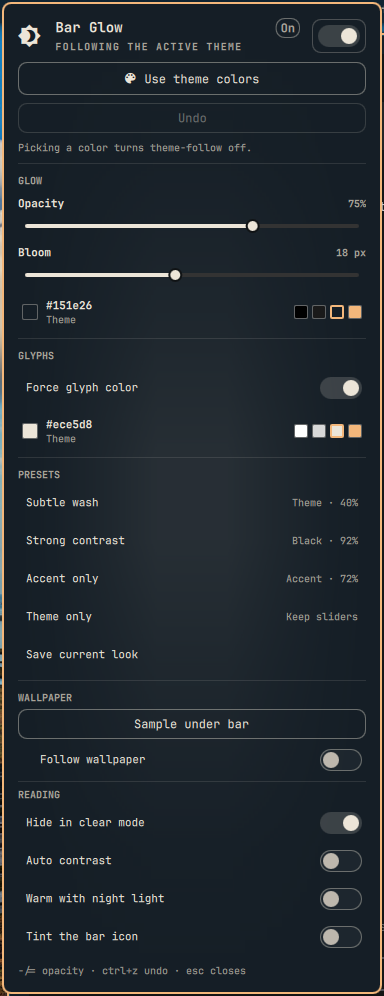

# Bar Glow

A full-width glow behind the stock Omarchy bar, so icons and labels stay
readable on any wallpaper. It does not replace `omarchy.bar`.

The wash sits on the bottom layer and covers the bar strip, with a short
bloom past the inner edge. A settings panel tunes opacity, bloom, colors,
presets, and an optional wallpaper sample. The bar icon that opens the
panel is optional.



## Install

```bash
omarchy plugin add https://github.com/07dcolem/bar-glow.git --enable
```

Omarchy asks which bar section to use. The default is **right**. That chip
opens the panel. To keep the glow without the chip, see
[Settings panel](#settings-panel).

If the folder is already at `~/.config/omarchy/plugins/bar-glow/`:

```bash
omarchy plugin validate ~/.config/omarchy/plugins/bar-glow
omarchy-shell shell rescanPlugins
omarchy plugin enable bar-glow --section right
omarchy restart shell
```

Confirm:

```bash
hyprctl layers | grep -E 'omarchy-bar$|omarchy-bar-glow'
omarchy-shell bar-glow status
omarchy-shell bar-glow toggle
```

With a top bar, a bottom-layer wash covers the bar strip and blooms past
its inner edge. Sizes follow the screen and the bloom setting. A 1920×26
bar with the default bloom looks like this:

```
Layer level 1 (bottom):
  ... xywh: 0 0 1920 44, namespace: omarchy-bar-glow
Layer level 2 (top):
  ... xywh: 0 0 1920 26, namespace: omarchy-bar
```

The glow uses `ExclusionMode.Ignore`, so it does not reserve space. It is
on `WlrLayer.Bottom` and does not take pointer events, so it shows through
a clear bar and stays under widgets and popouts.

`omarchy-shell bar-glow status` reports `enabled`, `shown`, `hideInClear`,
and `barClear`. `shown` is false when the glow is off, the bar is hidden,
or Hide in clear mode is suppressing the wash.

## Remove

```bash
omarchy plugin remove bar-glow
```

That deletes `~/.config/omarchy/plugins/bar-glow/` and removes the plugin
from `shell.json`. Glyph color returns to the theme. Nothing is written
under `$OMARCHY_PATH` or `~/.local/share/omarchy`.

## Settings panel

Left-click the bar chip. The panel anchors to that icon.

The chip is optional. The plugin stays enabled while `bar-glow` is on the
bar or in `plugins[]`. To drop the chip and keep the glow:

1. Copy the `bar-glow` object from `bar.layout` into top-level `plugins[]`,
   settings included.
2. Delete it from the layout section.
3. Save `~/.config/omarchy/shell.json`. The shell reloads it.

Keep the entry in one place. `omarchy plugin remove` deletes the first
match, and the bar layout wins, so a second `plugins[]` copy would survive
removal. Deleting the layout entry without adding `plugins[]` disables the
plugin and the glow stops.

With the chip hidden, the same panel opens from either command:

```bash
omarchy-shell bar-glow toggle
omarchy-shell shell toggle bar-glow
```

Those commands use the overlay. It has no icon to attach to, so the panel
uses the top-left fallback. Clicking the chip, when it is on the bar,
still anchors the panel to the icon. Forced glyph color and theme-follow
still apply with the chip hidden.

The panel is a stock Omarchy `KeyboardPanel`. Corners stay square unless
the theme sets `Style.cornerRadius`.

Color rows show a live swatch, a hex label (`Theme` or `Custom`), and a
few presets (black or white, plus the theme background, foreground, and
accent). The swatches follow the theme while theme-follow is on. The
swatch and the label open the full picker in a card on that row:
saturation field, hue bar, presets, and hex. Escape, Enter, or a click on
the rest of the panel closes only that card. Shift+Left / Shift+Right move
the hue. Plain arrows move saturation and value.

A faint even tint sits behind the controls and follows the glow color and
the glyph color. It brightens for a moment when a setting or color changes,
and fades toward the edges.

| Control | What it does |
|---|---|
| On/off switch | Show or hide the glow. This is the saved `enabled` value |
| **Use theme colors** | Glow = theme background, glyphs = theme foreground, and both follow `omarchy theme set` |
| **Undo** | Step back through changes made since the panel opened. Ctrl+Z does the same. Closing the panel drops that history |
| Opacity | Peak alpha of the wash, 20–100%. `-` and `=` nudge it by 2% while the panel is open |
| Bloom | Soft falloff past the inner edge, 0–40 px |
| Glow color | Compact row. A custom pick turns off theme-follow and wallpaper-follow |
| Force glyph color | Override bar icon and label color |
| Glyph color | Compact row, same picker as the glow. Disabled when Force is off |
| **Subtle wash** | Theme colors, 40% opacity, 8 px bloom, force glyphs on |
| **Strong contrast** | Black glow, white glyphs, 92% opacity, 32 px bloom |
| **Accent only** | Current accent glow, current foreground glyphs, 72% opacity, 16 px bloom |
| **Theme only** | Theme-follow on. Opacity and bloom stay where the sliders are |
| **Save current look** | Store this look under a name (up to 8). `x` deletes the saved row under the cursor. Does not store On/off or Hide in clear mode |
| **Sample under bar** | Average the wallpaper behind the bar, set the glow to it, and set the glyph to black or white |
| Follow wallpaper | Nested under sampling. Re-samples when the wallpaper changes |
| Hide in clear mode | Off by default. Suppress the wash while the bar background is clear. Glassy and opaque are unchanged. Glyph color stays |
| Auto contrast | Off by default. On a light strip, raises opacity (at least 88%) and forces the glyph light or dark. The saved glow hue stays |
| Warm with night light | Off by default. While `hyprsunset` is warmer than 6000K, the glow shifts toward that temperature |
| Tint the bar icon | Off by default. Colors the chip with the live glow |

Changes apply on the click, then persist to `~/.config/omarchy/shell.json`.
Arrow keys move between rows. Enter or Space activates the row. Esc closes
the panel. Theme changes crossfade the wash over 420ms.

Sampling uses `/usr/bin/magick` on the current Omarchy background
(`~/.local/state/omarchy/current/background`). It crops the strip the bar
covers, using the same center-crop as the background layer. One color is
shared across monitors. The sample uses the screen the panel is on, or the
focused screen when follow runs with the panel closed. If ImageMagick is
missing, the sample row says it could not read the wallpaper and leaves
the current colors alone.

### Keys

With the panel open:

| Key | Action |
|---|---|
| Up / Down, or `k` / `j` | Move between rows |
| Left / Right | Nudge the slider under the cursor, or step through that row's preset swatches |
| Enter / Space | Activate the row. On a color row, opens the picker |
| `-` / `=` | Opacity down / up by 2%, from any row |
| `x` | Remove the saved preset under the cursor |
| Esc | Close the picker if it is open, otherwise close the panel |
| Ctrl+Z | Undo the last change made since the panel opened |

In the picker, arrows change the field, Shift+Left / Shift+Right change the
hue, and Esc returns to the panel.

Summon the panel from anywhere:

```bash
omarchy-shell bar-glow open
omarchy-shell bar-glow close
omarchy-shell bar-glow toggle
```

To bind that yourself, add a free chord in `~/.config/hypr/bindings.lua`.
This plugin does not install a binding. For example:

```lua
o.bind("SUPER + CTRL + G", "Bar glow", "omarchy-shell bar-glow toggle")
```

Check current bindings before choosing a chord. `SUPER + CTRL + G` is only
an illustration. `omarchy-shell shell toggle bar-glow` is the same toggle.

## `shell.json` keys

Settings live on the bar-widget entry while the chip is on the bar. With
the chip hidden they live on the `plugins[]` entry. When the chip is
present, only the bar entry is written, so `omarchy plugin remove` does
not leave a second copy behind.

```json
{
  "id": "bar-glow",
  "enabled": true,
  "size": 18,
  "opacity": 0.72,
  "color": "#000000",
  "forceWhite": true,
  "contentColor": "#ffffff",
  "followTheme": false,
  "followWallpaper": false,
  "hideInClear": false,
  "autoContrast": false,
  "nightLight": false,
  "tintChip": false,
  "customPresets": []
}
```

| Key | Type | Default | Meaning |
|---|---|---|---|
| `enabled` | boolean | `true` | Draw the glow. Hide in clear mode does not change this |
| `size` | integer | `18` | Bloom in px (0–48). `0` is wash only |
| `opacity` | number | `0.72` | Peak alpha. Values `> 1` are treated as percent. Auto contrast can raise the live value without changing this |
| `color` | string | `#000000` | Glow hex, or `theme` for `Color.background` |
| `followTheme` | boolean | `false` | Live-bind glow and glyphs to the active theme |
| `forceWhite` | boolean | `true` | Force glyph color. The name is historical. The color is `contentColor` |
| `contentColor` | string | `#ffffff` | Forced glyph hex, or `theme` for `Color.foreground` |
| `followWallpaper` | boolean | `false` | Re-sample the bar strip when the wallpaper changes |
| `hideInClear` | boolean | `false` | Suppress the wash while the bar background is clear (`none`). Glassy and opaque still draw it |
| `autoContrast` | boolean | `false` | Raise opacity on a light strip and force a light or dark glyph |
| `nightLight` | boolean | `false` | Warm the live glow toward the hyprsunset temperature |
| `tintChip` | boolean | `false` | Tint the bar chip with the live glow color |
| `customPresets` | array | `[]` | Up to eight saved looks: name, colors, opacity, bloom, and the look toggles (`forceWhite`, `followTheme`, `followWallpaper`, `autoContrast`, `nightLight`, `tintChip`) |

**Use theme colors** and **Theme only** write `followTheme` and turn
wallpaper-follow off. A custom color clears both follows. A saved look
restores the fields it stored. It does not change `enabled` or
`hideInClear`.

## Behavior

- Follows bar position (top, bottom, left, right), including a live move.
- Hides with the bar (`shell.bar.barHidden`, including Super+Shift+Space).
- Hide in clear mode follows `bar.background` in `shell.json`. The bar
  writes that value when the background changes, and the glow service
  reloads the file. The wash drops for `none` and returns for glassy or
  opaque. The On/off switch and the forced glyph color stay as saved.
- One glow surface per monitor.
- A click applies immediately through the service, then
  `updateEntryInline` writes `shell.json`. While the chip is on the bar
  that write goes to the layout entry. With the chip hidden it goes to
  `plugins[]`. The service reads that file, so either location reaches
  the glow.
- Forced glyph color is owned by the service. It copies the theme shell
  values and sets `bar.text`. It does not assign `Color.bar.text`, so the
  bar's own color binding stays intact. The previous `bar.text` comes back
  when the glow is off, force-glyphs is off (and auto contrast is off), or
  the plugin is removed or disabled. Hiding the wash in clear mode does
  not release the glyph color. Theme-follow tracks `Color.foreground`,
  including `omarchy theme set`. A theme change crossfades the wash over
  420ms.
- Auto contrast and night light change the live wash only. They do not
  rewrite the saved glow hex. Wallpaper follow does write the sampled color.

## What this plugin does not do

- It does not become the active bar.
- It does not intercept pointer events (`mask: Region {}`).
- It does not change window gaps, rounding, or `decoration.shadow`.
- It does not hide the glow in glassy mode.
- Colorful tray app icons keep their own pixels. Glyphs and labels follow
  the forced color when that toggle is on.

## Development

```bash
omarchy plugin validate .
omarchy-shell shell rescanPlugins
omarchy restart shell
omarchy-shell bar-glow status
```

Kinds: `service` (`Service.qml`, the glow and the glyph-color override),
`bar-widget` (`GlowChip.qml`, optional bar icon), and `overlay`
(`GlowPanel.qml`). Not `bar`. Files are not named `BarWidget.qml` or
`Panel.qml`, so they do not collide with `qs.Ui`.

## Author

`07dcolem` — https://github.com/07dcolem/bar-glow

## Disclaimer

This plugin is provided as-is, with no warranty of any kind. Omarchy
plugins run unsandboxed inside your shell process, with the same access
as your user account. Review the code before you enable it. The author
is not liable for data loss, desktop breakage, theme changes, or any
other damage from installing, using, or removing this plugin. A
marketplace listing, if any, is not a security review.

## License

MIT. Copyright (c) 2026 Dylan Coleman. See [LICENSE](LICENSE).
